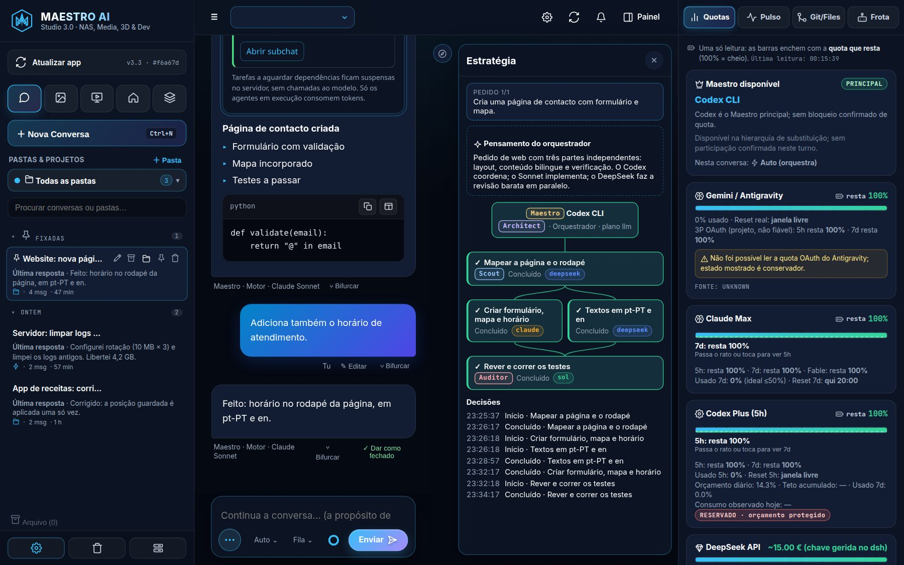
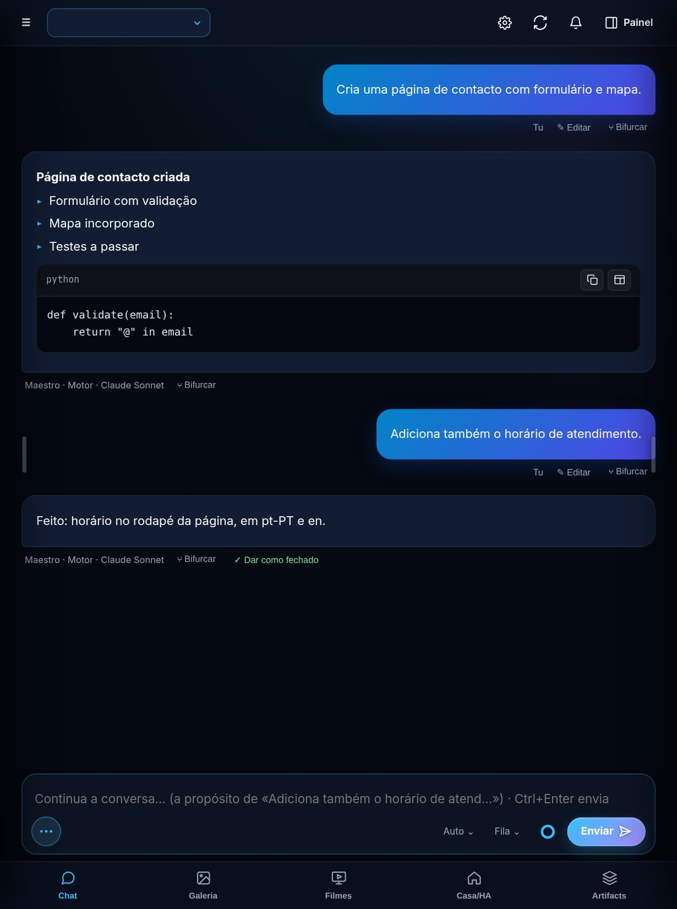
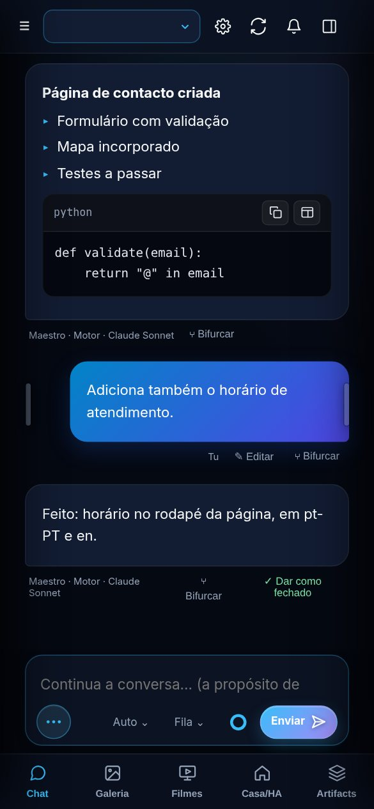
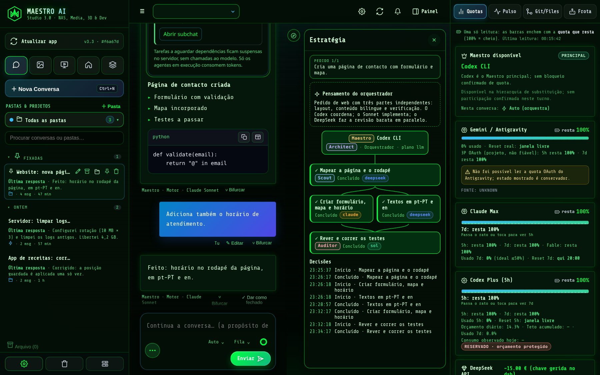
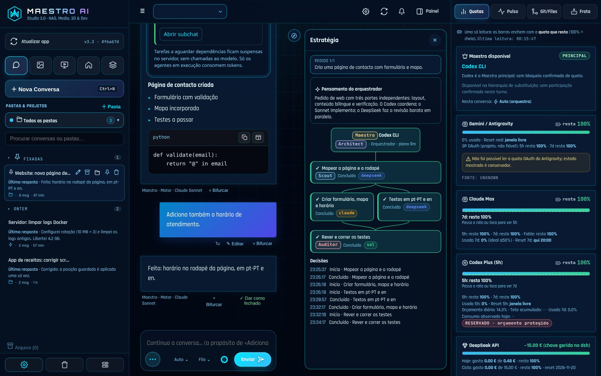
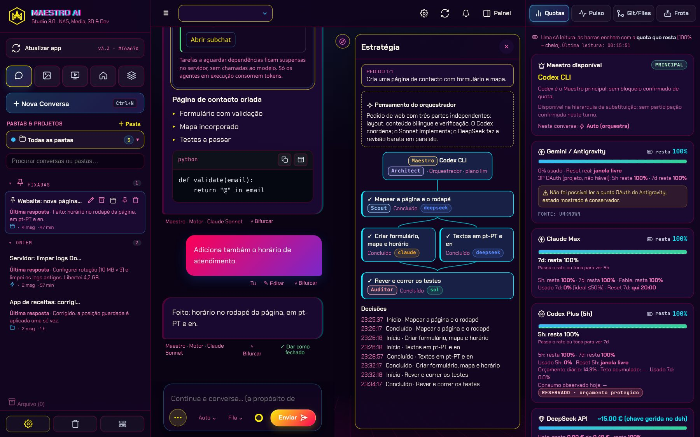
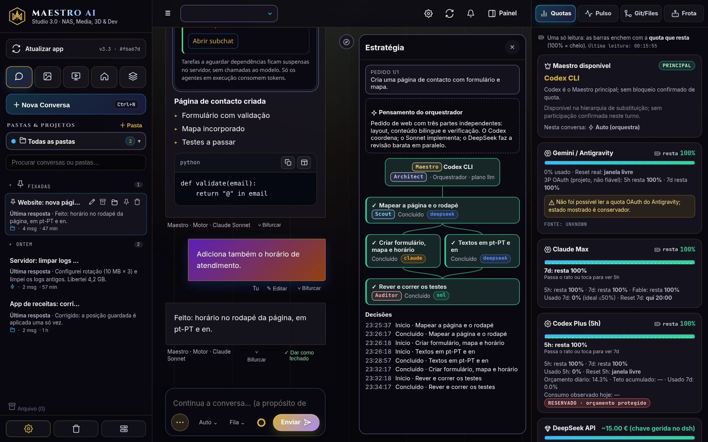
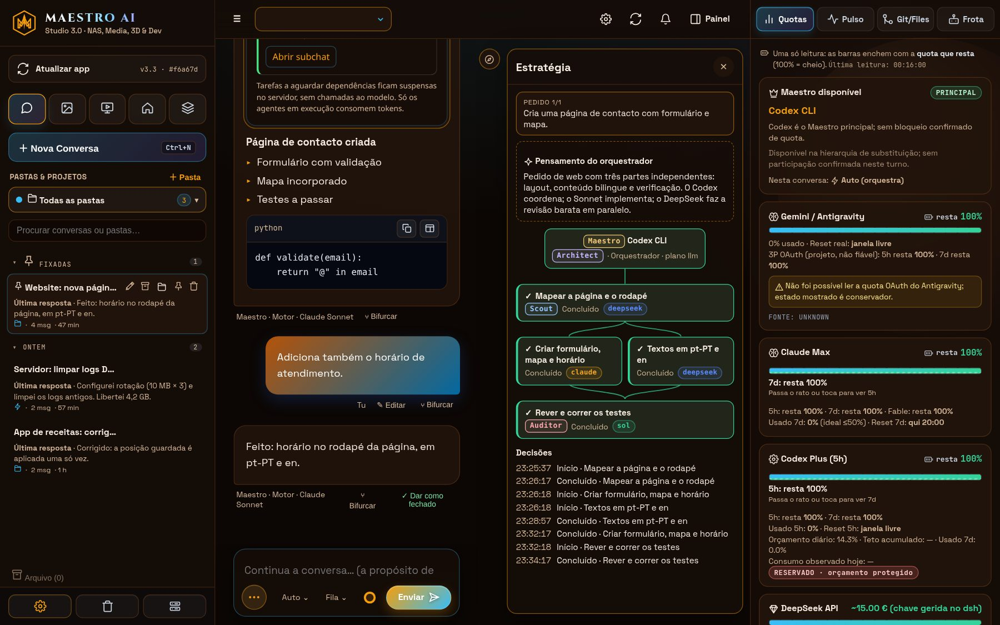
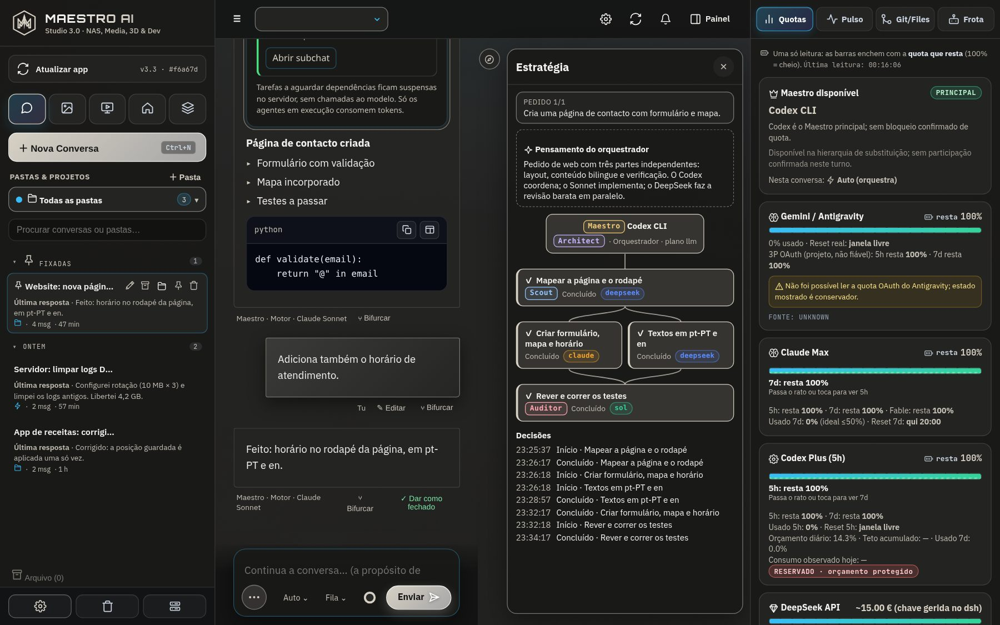

# Maestro AI

**A local orchestrator for AI coding agents.** Maestro routes each request to the right engine (Claude, Codex, Gemini/Antigravity, DeepSeek), plans multi-agent work as a dependency graph, and keeps every model inside a daily and weekly quota budget. It ships with a web app (desktop, tablet and phone, installable as a PWA).

🇵🇹 [Versão em português (PT-PT)](README.pt-PT.md)

> **License:** source-available, not open source. Free for personal, study, research and hobby use under [PolyForm Noncommercial 1.0.0](LICENSE). Commercial use needs a paid licence — see [COMMERCIAL.md](COMMERCIAL.md) (reference price: €100 in Europe).

## What it does

- **Engine routing and fallback.** Classifies a request by domain and size, picks the engine, and falls back by quota (e.g. Codex → Antigravity → Claude → DeepSeek).
- **Multi-agent workflows.** Complex requests become a JSON plan (scout → specialist → review), executed as a DAG with parallel read-only tasks. Plans and results are persisted and resumable.
- **Quota budgets.** Weekly quotas are split into daily budgets; DeepSeek has a per-cycle money budget with yellow/red lines for justified extra use.
- **Read-only scouts.** A restricted DeepSeek API mode that can only list folders, read excerpts and grep inside the project.
- **Strategy panel.** Follows the request you are reading and shows the orchestrator's reasoning, the agent graph, per-node status and a decision timeline.
- **Web studio.** Chats and folders with archive, a request queue, live quota and fleet panels, six visual worlds, PT/EN interface, installable PWA.
- **Interactive answers.** Replies can render inline HTML, tables, charts, and step-by-step Q&A cards per platform.
- **Optional integrations** (NAS media, Home Assistant, 3D printers) live in `maestro_features.py` and are configured by you.

See [ORCHESTRATION.md](ORCHESTRATION.md) (in Portuguese) for the design details and [DEEPSEEK_PRICING.md](DEEPSEEK_PRICING.md) for the cost model.

## Screenshots

<p align="center"></p>

*Desktop: chat list, conversation, the **Strategy panel** (the orchestrator's reasoning and the agent graph of the request you are reading) and live quota bars.*

<p align="center"> &nbsp; </p>

*Tablet and phone run the same interface as an installable PWA; the Windows app is the same UI in its own window.*

### Themes ("worlds")

Each world re-skins colour, type and effects of the whole app. Pick one from the logo menu.

<table><tr>
<td align="center"><br/><sub>Matrix</sub></td>
<td align="center"><br/><sub>Sci-Fi HUD</sub></td>
<td align="center"><br/><sub>Cyberpunk</sub></td>
</tr><tr>
<td align="center"><br/><sub>Hesperia</sub></td>
<td align="center"><br/><sub>Dune · Arrakis</sub></td>
<td align="center"><br/><sub>Hubert Dungen</sub></td>
</tr></table>

*All captures use a demo workspace with fictional conversations; the quota bars show demo values.*

## Requirements

- Linux (developed on a home NAS), Python 3.11+
- The agent CLIs you want to use, already logged in: `claude`, `codex`, `agy`, and/or a DeepSeek API key
- Optional, for GIF export: `pip install -r requirements-gif.txt` into `.gif-deps/`

## Quick start

```bash
git clone https://github.com/hubertdungen/maestro-ai.git
cd maestro-ai
python3 maestro.py --status          # quotas, resets, balances
python3 maestro.py --plan "your request"   # preview the agent plan
python3 maestro.py "your request"          # run it
python3 maestro_web.py               # web studio on port 8109
python3 -m unittest discover -s tests -q
```

Credentials (API keys, tokens) are read from your environment or local state under `~/.local/state/maestro/`. Never commit them.

## Status

Personal project, used daily by its author. Interfaces change without notice. Issues are welcome; support is best-effort unless covered by a commercial licence.

## License

Copyright © 2026 Hubert Dungen. [PolyForm Noncommercial 1.0.0](LICENSE) for noncommercial use; [commercial licence](COMMERCIAL.md) otherwise. Not legal advice.
