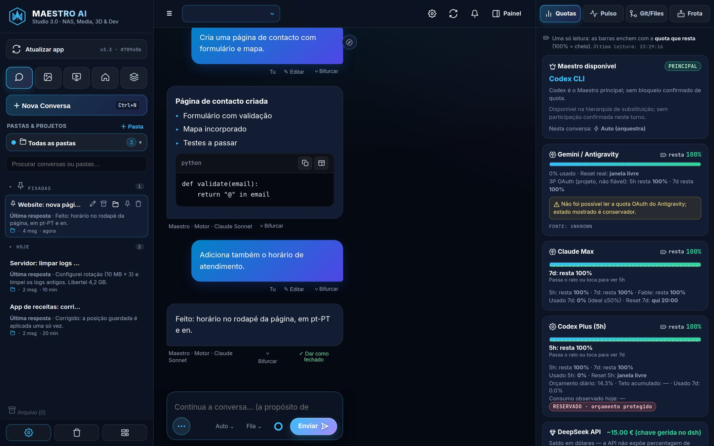
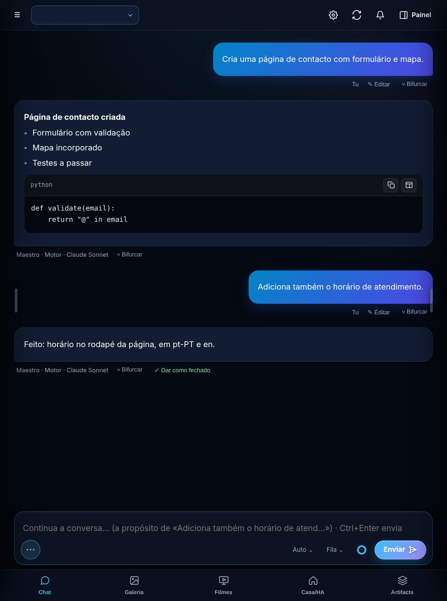
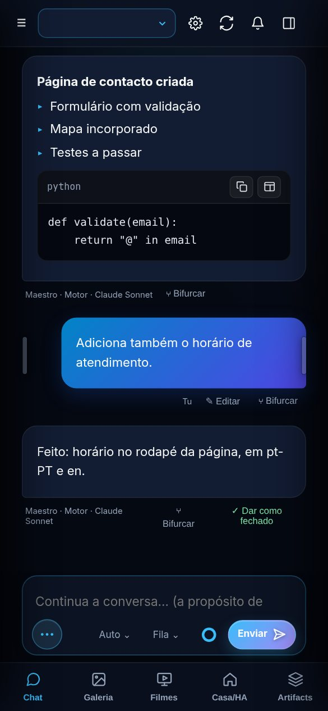
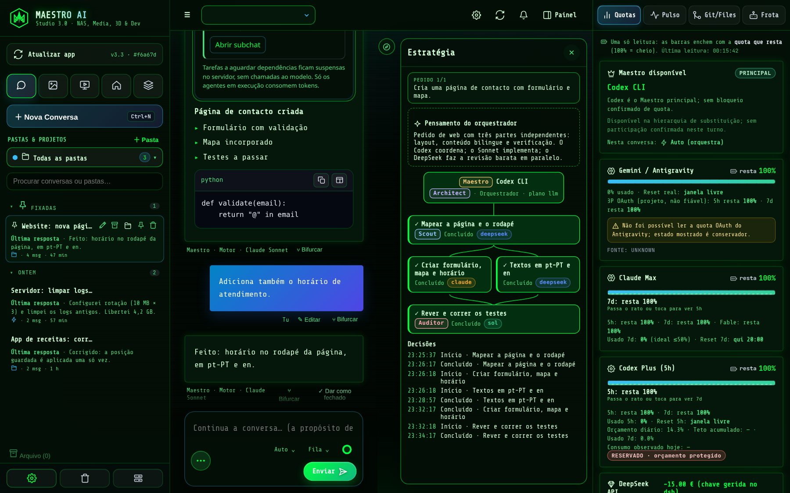
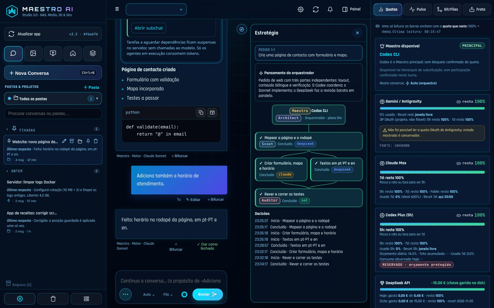
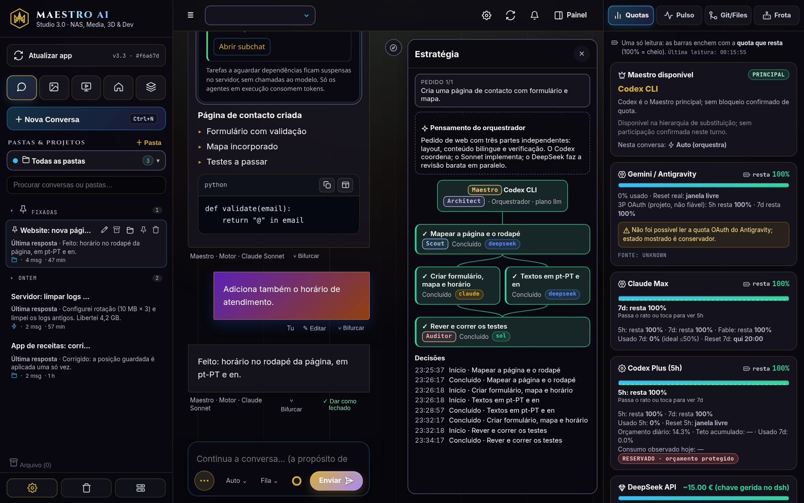
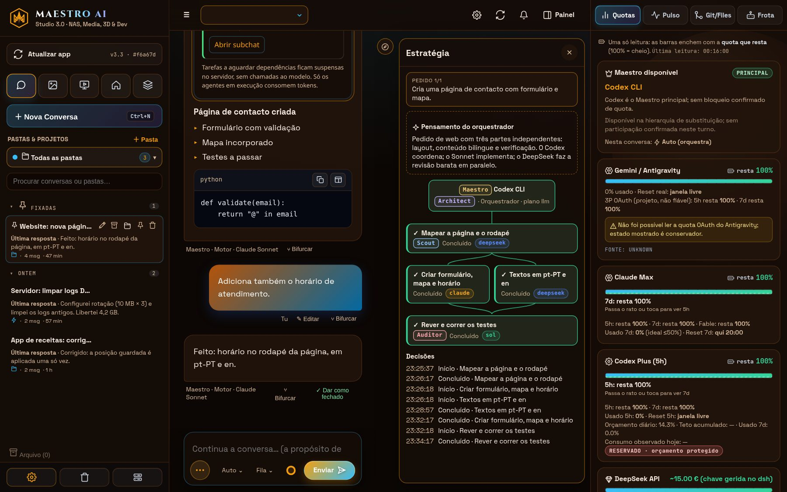

# Maestro AI

**Uma só porta de entrada para todos os agentes de IA que pagas.** O Maestro lê cada pedido, escolhe o motor certo (Claude, Codex, Gemini/Antigravity, DeepSeek), divide os trabalhos grandes num plano multiagente e mantém cada modelo dentro da quota diária e semanal — deixas de vigiar limites e passas a entregar.

🇬🇧 [English version](README.md)

<p align="center"></p>

> **Licença:** código disponível, não open source. Gratuito para uso pessoal, estudo, investigação e lazer sob [PolyForm Noncommercial 1.0.0](LICENSE). O uso comercial exige licença paga — ver [COMMERCIAL.md](COMMERCIAL.md) (preço de referência: 100 € na Europa).

## Porquê

As subscrições e os créditos de API esgotam-se em alturas diferentes, cada CLI tem os seus limites e uma tarefa longa pode gastar uma semana de quota numa tarde. O Maestro trata-os como uma frota: sabe o que resta a cada motor, encaminha por domínio e dimensão e muda sozinho para outro quando um se esgota.

## Como funciona

```text
pedido ─► triagem ─► simples? ─► um motor ─► resposta
          (domínio,   │
           dimensão,  └─ grande? ─► plano (DAG em JSON)
           quota)                  ├─ scout        (só leitura, barato)
                                   ├─ especialista (escreve código) ┐ em paralelo
                                   └─ revisor      (verifica)       ┘ onde independentes
                                              │
                              gate de QA ◄────┘ ─► resposta + painel Estratégia
```

## Funcionalidades

| | |
|---|---|
| **Encaminhamento e fallback** | Classifica por domínio e dimensão e muda por quota (ex.: Codex → Antigravity → Claude → DeepSeek). |
| **Fluxos multiagente** | Pedidos complexos viram um grafo de dependências (scout → especialista → revisão), com tarefas de leitura em paralelo. Planos e resultados ficam guardados e podem ser retomados. |
| **Painel Estratégia** | Ao lado do chat: o raciocínio do orquestrador, o grafo de agentes, o estado de cada nó, o motor/modelo usado e a cronologia de decisões. Acompanha o pedido que estás a ler; sem nenhum à vista mostra o último ou o plano ao vivo. |
| **Orçamentos de quota** | As quotas semanais dividem-se em orçamentos diários; o DeepSeek tem um orçamento em dinheiro por ciclo, com barra diária e linhas amarela/vermelha para uso extra justificado. |
| **Scouts só de leitura** | Um modo restrito da API DeepSeek que só lista pastas, lê excertos e faz grep dentro do projeto. |
| **Estúdio web** | Chats e pastas com arquivo, fila de pedidos, quotas e frota ao vivo, seis mundos visuais, interface PT/EN e PWA instalável em computador, tablet e telemóvel. |
| **Respostas interativas** | As respostas podem mostrar HTML, tabelas, gráficos e cartões de perguntas e respostas passo a passo por plataforma. |
| **Integrações opcionais** | Média do NAS, Home Assistant e impressoras 3D vivem em `maestro_features.py`; configuras tu. |

Detalhes de desenho: [ORCHESTRATION.md](ORCHESTRATION.md). Modelo de custos: [DEEPSEEK_PRICING.md](DEEPSEEK_PRICING.md).

## Capturas

O **painel Estratégia** (à direita do chat) mostra o plano que o orquestrador montou para o pedido: o raciocínio, quem faz o quê e o que está concluído.

<p align="center"> &nbsp; </p>

*Tablet e telemóvel usam a mesma interface como PWA instalável; a app Windows é a mesma UI numa janela própria.*

### Temas («mundos»)

Cada mundo muda cor, tipo de letra e efeitos de toda a app. Escolhe no menu do logótipo.

<table><tr>
<td align="center"><br/><sub>Matrix</sub></td>
<td align="center"><br/><sub>Sci-Fi HUD</sub></td>
<td align="center"><br/><sub>Cyberpunk</sub></td>
</tr><tr>
<td align="center"><br/><sub>Hesperia</sub></td>
<td align="center"><br/><sub>Dune · Arrakis</sub></td>
<td align="center"><br/><sub>Hubert Dungen</sub></td>
</tr></table>

*As capturas usam um espaço de demonstração com conversas fictícias; as barras de quota mostram valores de demonstração.*

## Requisitos

- Linux (desenvolvido num NAS doméstico), Python 3.11+
- As CLIs de agentes que queres usar, já com sessão iniciada: `claude`, `codex`, `agy` e/ou uma chave da API DeepSeek
- Opcional, para exportar GIF: `pip install -r requirements-gif.txt` para `.gif-deps/`

## Início rápido

```bash
git clone https://github.com/hubertdungen/maestro-ai.git
cd maestro-ai
python3 maestro.py --status                # quotas, resets, saldos
python3 maestro.py --plan "o teu pedido"   # pré-visualizar o plano
python3 maestro.py "o teu pedido"          # executar
python3 maestro_web.py                     # estúdio web na porta 8109
python3 -m unittest discover -s tests -q
```

As credenciais (chaves, tokens) lêem-se do ambiente ou do estado local em `~/.local/state/maestro/`. Nunca as faças commit.

## Status

Projeto pessoal, usado diariamente pelo autor. As interfaces mudam sem aviso. Issues são bem-vindos; o suporte é feito na medida do possível, salvo licença comercial.

## Licença

Copyright © 2026 Hubert Dungen. [PolyForm Noncommercial 1.0.0](LICENSE) para uso não comercial; [licença comercial](COMMERCIAL.md) nos restantes casos. Não é aconselhamento jurídico.
