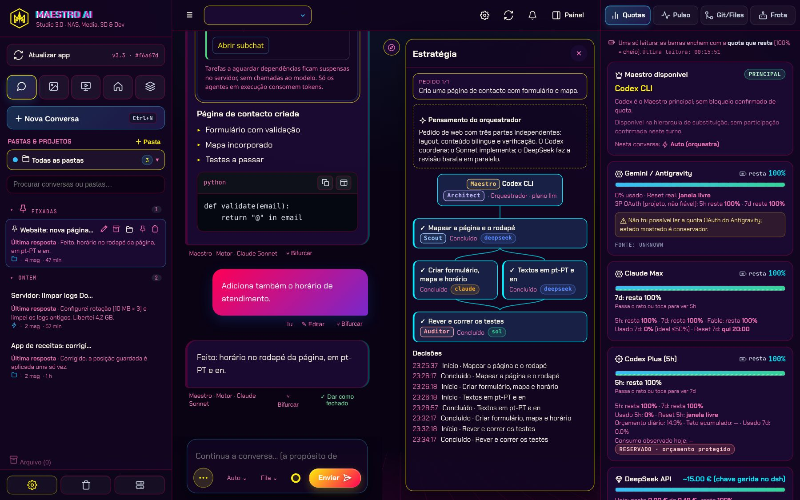

# Maestro AI

**Um orquestrador local de agentes de IA para programação.** O Maestro encaminha cada pedido para o motor certo (Claude, Codex, Gemini/Antigravity, DeepSeek), planeia trabalho multiagente como um grafo de dependências e mantém cada modelo dentro de um orçamento diário e semanal de quota. Inclui uma aplicação web (computador, tablet e telemóvel, instalável como PWA).

🇬🇧 [English version](README.md) (versão base)

> **Licença:** *source-available*, não é open source. Gratuito para uso pessoal, de estudo, investigação e hobby ao abrigo da [PolyForm Noncommercial 1.0.0](LICENSE). O uso comercial exige licença paga — ver [COMMERCIAL.md](COMMERCIAL.md) (preço de referência: 100 € na Europa).

## O que faz

- **Encaminhamento e substituição de motores.** Classifica o pedido por domínio e dimensão, escolhe o motor e substitui-o por quota (ex.: Codex → Antigravity → Claude → DeepSeek).
- **Fluxos multiagente.** Pedidos complexos tornam-se um plano JSON (scout → especialista → revisão), executado como DAG com tarefas de leitura em paralelo. Planos e resultados ficam guardados e podem ser retomados.
- **Orçamentos de quota.** As quotas semanais dividem-se em orçamentos diários; o DeepSeek tem um orçamento em euros por ciclo, com *yellowline* e *redline* para uso extra justificado.
- **Scouts só de leitura.** Modo restrito da API DeepSeek que apenas lista pastas, lê excertos e pesquisa texto dentro do projeto.
- **Painel Estratégia.** Acompanha o pedido que estás a ler e mostra o raciocínio do orquestrador, o grafo de agentes, o estado de cada nó e a linha temporal das decisões.
- **Estúdio web.** Conversas e pastas com arquivo, fila de pedidos, painéis de quotas e frota em direto, seis mundos visuais, interface PT/EN, PWA instalável.
- **Respostas interativas.** As respostas podem trazer HTML inline, tabelas, gráficos e cartões de perguntas e respostas por plataforma.
- **Integrações opcionais** (multimédia no NAS, Home Assistant, impressoras 3D) em `maestro_features.py`, configuradas por ti.

Os detalhes do desenho estão em [ORCHESTRATION.md](ORCHESTRATION.md) e o modelo de custos em [DEEPSEEK_PRICING.md](DEEPSEEK_PRICING.md).

## Capturas de ecrã

<p align="center"></p>

*Computador: lista de conversas, conversa, **painel Estratégia** (o raciocínio do orquestrador e o grafo de agentes do pedido que estás a ler) e barras de quota em direto.*

<p align="center"> &nbsp; </p>

*Tablet e telemóvel usam a mesma interface como PWA instalável; a app Windows é a mesma UI numa janela própria.*

### Temas («mundos»)

Cada mundo muda cor, tipografia e efeitos de toda a app. Escolhe-se no menu do logótipo.

<table><tr>
<td align="center"><br/><sub>Matrix</sub></td>
<td align="center"><br/><sub>Sci-Fi HUD</sub></td>
<td align="center"><br/><sub>Cyberpunk</sub></td>
</tr><tr>
<td align="center"><br/><sub>Hesperia</sub></td>
<td align="center"><br/><sub>Dune · Arrakis</sub></td>
<td align="center"><br/><sub>Hubert Dungen</sub></td>
</tr></table>

*Todas as capturas usam um espaço de demonstração com conversas fictícias; as barras de quota mostram valores de demonstração.*

## Requisitos

- Linux (desenvolvido num NAS doméstico), Python 3.11+
- Os CLI de agentes que quiseres usar, com sessão iniciada: `claude`, `codex`, `agy` e/ou uma chave da API DeepSeek
- Opcional, para exportar GIF: `pip install -r requirements-gif.txt` para `.gif-deps/`

## Arranque rápido

```bash
git clone https://github.com/hubertdungen/maestro-ai.git
cd maestro-ai
python3 maestro.py --status                # quotas, resets, saldos
python3 maestro.py --plan "o teu pedido"   # pré-visualiza o plano de agentes
python3 maestro.py "o teu pedido"          # executa
python3 maestro_web.py                     # estúdio web na porta 8109
python3 -m unittest discover -s tests -q
```

As credenciais (chaves de API, tokens) são lidas do ambiente ou do estado local em `~/.local/state/maestro/`. Nunca as comites.

## Estado

Projeto pessoal, usado diariamente pelo autor. As interfaces mudam sem aviso. Issues são bem-vindas; o suporte é feito na medida do possível, salvo se estiver coberto por licença comercial.

## Licença

Copyright © 2026 Hubert Dungen. [PolyForm Noncommercial 1.0.0](LICENSE) para uso não comercial; [licença comercial](COMMERCIAL.md) nos restantes casos. Não constitui aconselhamento jurídico.
